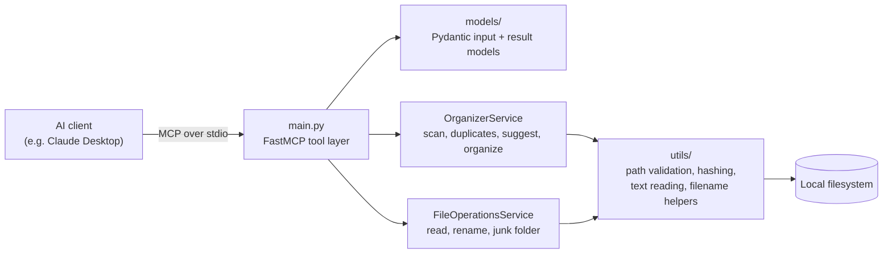

# Organizer MCP Server

A Python [Model Context Protocol](https://modelcontextprotocol.io) (MCP) server that lets an AI assistant scan, read, rename, de-duplicate and reorganize files in local folders through a small set of explicit tools.

[Watch the demo](mcpDemo.mp4)

## Overview

Cleaning up a messy folder (`Document1.pdf`, `Untitled.doc`, `IMG_001.jpg`, ...) normally means opening each file, deciding what it is, and moving it by hand. This server exposes the mechanical parts of that job as MCP tools and leaves the judgment to the AI client:

- The **server** does deterministic file work: walking directories, hashing, reading text, renaming, moving, and writing a log.
- The **AI client** (for example Claude Desktop) decides what the files are about, what to call them, and which category folder each one belongs in, then calls the tools to carry that out.

The server contains no categorization rules and no language model of its own. Category names come entirely from the `organization_map` the client sends to `organize_folder`.

## Key Features

Seven MCP tools, all registered in [main.py](main.py):

| Tool | What it does |
|------|--------------|
| `scan_folder` | Recursively lists files and returns totals, per-extension counts and sizes, text/binary counts, hidden-file count, and a list of files whose names look generic. |
| `find_duplicates` | Finds identical files: groups by size first, then SHA-256 hashes only files that share a size. Returns groups, file count, and wasted space. |
| `read_file` | Returns metadata and text content (up to `max_size` bytes, default 50000) with a `truncated` flag. |
| `suggest_filename` | Heuristic name suggestions for text files (first line, plus up to 3 keywords from the first 100 words). For non-text files it only suggests a type-based name such as `image.jpg`. |
| `rename_file` | Renames a file within its folder; refuses to overwrite an existing file. |
| `create_junk_folder` | Moves the given files into a quarantine folder (default `_junk`). Renames on name conflict. Does not delete anything. |
| `organize_folder` | Moves files into category folders according to a `{file_path: category}` map, creates the folders, and writes a `REDIRECT.txt` log in the target folder. |

Behaviours worth knowing:

- Tool calls run the blocking file work in a worker thread via `asyncio.to_thread`, so the MCP event loop is not blocked.
- Every tool returns a uniform `{ok, data, error}` result (see [models/result.py](models/result.py)); failures come back as structured errors with a code instead of raising to the client.
- File destinations are never overwritten: name conflicts get a `_1`, `_2`, ... suffix.

## Architecture and Workflow



Typical session, as described by the tool design:

1. The client calls `scan_folder` to see what is in the folder and which names are generic.
2. It calls `read_file` on unclear files, and optionally `find_duplicates`.
3. The client decides on categories and calls `organize_folder` with a map of file path to category (and `rename_file` / `create_junk_folder` as needed).
4. The server moves the files and writes `REDIRECT.txt` listing each move, so the changes can be reviewed.

Components:

- [main.py](main.py): creates the `FastMCP` server, validates inputs with Pydantic, registers the tools, and runs over MCP's default transport (`mcp.run()`).
- [services/organizer_service.py](services/organizer_service.py): scanning, duplicate detection, filename suggestion, organizing, `REDIRECT.txt` generation.
- [services/file_operations_service.py](services/file_operations_service.py): reading, renaming, junk folder.
- [utils/validate.py](utils/validate.py): path validation and the allow-list check.
- [utils/file_utils.py](utils/file_utils.py): hashing, text/binary detection, encoding fallback, directory walking, filename sanitizing.
- [models/](models/): Pydantic input models and result models.

## Technology Stack

- **Python 3.11+** (`requires-python` in [pyproject.toml](pyproject.toml))
- **`mcp`** (official MCP Python SDK, `FastMCP` API): exposes the tools to clients
- **Pydantic v2**: input validation and result serialization
- **python-dotenv**: loads `.env` at startup
- **pytest / pytest-asyncio**: tests (dev dependencies)
- Standard library: `hashlib`, `pathlib`, `shutil`, `asyncio`

## Prerequisites

- Python 3.11 or newer
- An MCP-compatible client (the examples use Claude Desktop)

## Installation and Setup

```bash
git clone https://github.com/Yocheved4427/organizer-mcp-server.git
cd organizer-mcp-server

python -m venv .venv
.venv\Scripts\activate          # Windows
# source .venv/bin/activate     # macOS / Linux

pip install -r requirements.txt
```

Optional: restrict which folders the server may touch (strongly recommended, see [Security](#error-handling-security-and-limitations)):

```bash
cp .env.example .env            # Windows: copy .env.example .env
```

Then edit `ORGANIZER_ALLOWED_PATHS` in `.env`, or set it in the client config as shown below.

## Configuration and AI Client Integration

Add the server to your Claude Desktop config file:

- **Windows:** `%APPDATA%\Claude\claude_desktop_config.json`
- **macOS:** `~/Library/Application Support/Claude/claude_desktop_config.json`

```json
{
  "mcpServers": {
    "organizer": {
      "command": "/absolute/path/to/organizer-mcp-server/.venv/bin/python",
      "args": ["/absolute/path/to/organizer-mcp-server/main.py"],
      "env": {
        "ORGANIZER_ALLOWED_PATHS": "/home/yourname/documents,/home/yourname/downloads"
      }
    }
  }
}
```

Replace the placeholders:

- `command`: the Python interpreter of the virtual environment where you installed the requirements (on Windows: `.venv\Scripts\python.exe`, written with forward slashes or escaped backslashes in JSON). Plain `"python"` also works if that interpreter has the dependencies installed.
- `args`: the absolute path to `main.py`.
- `ORGANIZER_ALLOWED_PATHS`: comma-separated absolute folders the server may access.

A template is also provided in [mcp.example.json](mcp.example.json). Restart the client after editing the config.

## Usage Examples

Once connected, ask the assistant in natural language; it chooses the tools. For example:

- "Scan my Downloads folder and tell me which files have generic names."
- "Find duplicate files in `~/Downloads` larger than 1 MB."
- "Read the files with generic names, then organize the folder into categories based on what they contain."

Under the hood the last request ends in a call like:

```json
{
  "tool": "organize_folder",
  "arguments": {
    "folder_path": "/home/yourname/downloads",
    "organization_map": {
      "/home/yourname/downloads/Document1.pdf": "Financial_Reports",
      "/home/yourname/downloads/IMG_001.jpg": "Photos"
    }
  }
}
```

Each tool returns `{"ok": true, "data": {...}}` on success or `{"ok": false, "error": {"code": "...", "message": "..."}}` on failure. For `organize_folder`, `data.organization` contains `files_moved`, `folders_created`, a per-file `changes` list, and the path to `REDIRECT.txt`.

[instructions.md](instructions.md) contains a longer step-by-step walkthrough written for the assistant.

## Project Structure

```
organizer-mcp-server/
├── main.py                  # FastMCP server and tool definitions
├── models/
│   ├── organizer_models.py  # Pydantic input models for each tool
│   └── result.py            # ToolResult and per-tool result models
├── services/
│   ├── organizer_service.py        # scan, duplicates, suggest name, organize
│   └── file_operations_service.py  # read, rename, junk folder
├── utils/
│   ├── validate.py          # path validation + allow-list
│   ├── file_utils.py        # hashing, text reading, filename helpers, walking
│   └── errors.py            # custom exceptions
├── tests/
│   └── test_organizer_service.py
├── .env.example             # environment configuration template
├── mcp.example.json         # client config template
├── instructions.md          # usage walkthrough
├── pyproject.toml
└── requirements.txt
```

## Error Handling, Security, and Limitations

**Error handling.** Services catch exceptions and return structured `ToolResult` errors (for example `folder_access_error`, `file_access_error`, `organize_error`). In `organize_folder` and `create_junk_folder`, a failure on one file is recorded and the rest continue.

**Access control.** Folder and file paths pass through `validate_folder_path` / `validate_file_path`:

- If `ORGANIZER_ALLOWED_PATHS` is set, a path must be inside one of the listed roots.
- If it is empty, the server only blocks a hard-coded list of system directories (`C:/Windows`, `C:/Program Files`, `/etc`, `/usr`, and similar). Everything else, including your whole home directory, is accessible. Set the allow-list.
- `rename_file` rejects new names containing path separators or `..`.

**Known limitations (from reading the code):**

- **No document parsing.** There is no PDF, OCR, or Office text extraction. `.docx`, `.doc` and `.odt` are classified as text by extension and read as plain text, so their extracted content will be unreadable binary-derived text. PDFs and images are treated as binary: `read_file` returns a placeholder instead of content.
- **Filename suggestions are heuristic:** first line and the first few words, not semantic analysis. Semantic understanding comes from the AI client.
- **`organize_folder` does not apply the allow-list to the file paths in `organization_map`**, only to `folder_path`. Source files are moved by path as given, so the allow-list should not be treated as a complete sandbox for that tool. Category names are sanitized for invalid characters but are not checked against `..`.
- **`create_junk_folder`'s `folder_name` is not validated.**
- `scan_folder` and `find_duplicates` stop at 10,000 files per call, and hidden files (names starting with `.`) are skipped unless `include_hidden` is true.
- `scan_folder`'s tool description mentions duplicates, but it does not compute them; use `find_duplicates`.
- Moves and renames are performed immediately and there is no undo command. `REDIRECT.txt` records what moved but nothing replays it.
- The `LOG_LEVEL`, `MAX_FILE_READ_SIZE`, `MIN_DUPLICATE_SIZE`, `SERVER_NAME`, `LOG_TO_FILE` and `LOG_FILE_PATH` entries in `.env.example` are not read anywhere in the code. Only `ORGANIZER_ALLOWED_PATHS` has an effect.
- This is a small project that has not been security audited; do not point it at folders you cannot afford to have reorganized.

## Testing

Tests use pytest and cover the service layer (read, rename, junk folder, duplicates, filename suggestion, organize, scan):

```bash
pip install pytest pytest-asyncio
python -m pytest
```

The eight tests passed when run locally (Python 3.14, pytest with pytest-asyncio). The MCP tool layer in `main.py` and the path-validation logic are not covered by tests.

## Future Improvements

Possible future work, not implemented:

- Extract text from PDF and Office documents, and optionally OCR images.
- Apply the allow-list to every path in `organization_map`, and validate `folder_name` and category names.
- Add a dry-run mode and an undo operation based on `REDIRECT.txt`.
- Wire up the logging and size settings already listed in `.env.example`.
- Add tests for path validation and the MCP tool layer.

## License

Released under the [MIT License](LICENSE).
